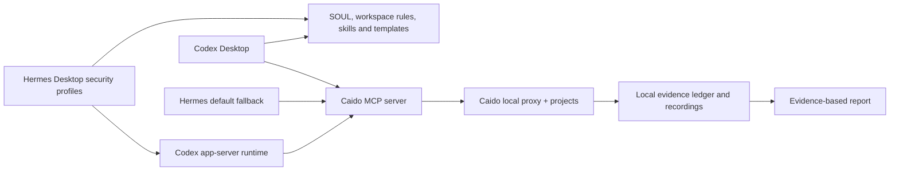

# Hermes + Caido security research workbench

A macOS desktop workbench for **authorized** bug bounty research and CTF practice. It combines Hermes Agent, Caido, Codex, evidence capture, reporting templates, and an organized index of public reports and writeups.

**Start here:** [research and setup report](REPORT.md) · [Hermes model profiles](docs/hermes-profile.md) · [macOS setup](docs/setup-macos.md) · [research workflow](docs/workflow.md) · [CTF writing](docs/ctf-writing.md) · [screen recording](docs/recording.md) · [public resource catalog](catalog/README.md) · [report template](templates/bug-report.md)

## What this repository contains

| Area | Contents |
|---|---|
| `docs/` | Desktop installation, Hermes Daybreak/Astra/Sol profiles, scoped research workflow, recording, maintenance |
| `catalog/resources.csv` | Curated links to public disclosure feeds, advisories, research blogs, CTF writeups, training, and reference standards |
| `catalog/classes.md` | Web vulnerability and CTF topic map with primary learning sources |
| `research/hackinghub/` | Source-labeled extraction from a separate HackingHub LinkedIn research task; read its coverage notes first |
| `skills/` | Portable agent instructions for Caido, local code review, CTF solving and first-person writeups, evidence, validation, and reporting |
| `templates/` | Engagement card, evidence ledger, bounty report, CTF writeup, and Hermes workspace instructions |
| `scripts/` | Catalog tools plus scoped Codex and offline Semgrep launchers |

## Scope and evidence rules

- Work only within a program's current written scope or an explicitly provided CTF/lab. Record the policy, exclusions, rate limits, and allowed techniques before sending test traffic.
- Public writeups explain historical findings; they do **not** authorize testing the named organization today.
- A proxy request, scanner hit, AI hypothesis, or CTF solution is a lead until the relevant result has been checked. Reports distinguish direct observation, researcher notes, inference, and unknowns.
- Keep raw traffic, credentials, recordings, and unpublished findings outside this public repository. Redact tokens, cookies, personal data, and unrelated traffic before sharing evidence.
- This is a **catalog of discovery sources**, not a copy of every report worldwide. Public reports are continually added, removed, and disclosed under different permissions. The catalog links to original publishers and does not mirror third-party writeups.

## Architecture

Caido's [MCP tutorial](https://docs.caido.io/app/tutorials/mcp) documents a community-maintained server. The connection here uses [`c0tton-fluff/caido-mcp-server`](https://github.com/c0tton-fluff/caido-mcp-server), not a Caido-built MCP binary. Pin and review its release before updating. Authentication is handled by its OAuth flow; do not put a token in a public config.

## Workbench version snapshot

Validated on Apple Silicon macOS on **2026-10-26**:

| Component | Installed version |
|---|---|
| Hermes Agent CLI/Desktop source | 0.22.5 stable |
| Codex CLI for Hermes app-server | 0.164.0; `security` requests Daybreak Blue on `gpt-6-sol`, `astra` and `sol61` use standard safeguards |
| Caido Desktop | 0.58.3 |
| Caido MCP server | 4.3.0 |
| OBS Studio | 33.0.0 |
| Nuclei / Subfinder / Katana | 3.11.1 / 2.17.0 / 1.8.0 |
| ffuf / dnsx / httpx (ProjectDiscovery) / Nmap | 2.3.0 / 1.3.1 / 1.12.0 / 7.992 |
| Wireshark CLI (`tshark`) / Z3 CLI | 4.6.9 / 5.3.1 |
| Semgrep CE / Trivy / Gitleaks | 1.182.0 / 0.76.1 / 8.30.1 |
| Ghidra / Java | 12.2 / OpenJDK 25.0.2 |
| CTF Python helpers | pwntools 4.15.0 / Scapy 2.8.0 / Z3 5.3.1.0 in a Python 3.12 venv |

Versions are a dated local snapshot, not a promise that they remain latest. Follow [maintenance](docs/maintenance.md) to review releases and upgrade selectively.

The active Hermes Desktop profile is `security`. It uses the ChatGPT/Codex subscription through Codex app-server with a profile-local `daybreak=true` request; `default` retains the working `gpt-6-sol-900k` fallback. [Profile details](docs/hermes-profile.md) explain what was tested and why Astra/GPT-6.1 Sol do not gain reduced refusals under Daybreak Blue. Start the local Caido instance before using its MCP tools.

## Make the catalog useful

The index is intentionally link-based. Filter `catalog/resources.csv` by `kind` or `topics`, follow the original publisher's page, and add a concise note to the local evidence ledger when a source influences a hypothesis. Run `python3 scripts/catalog.py check` after edits and `python3 scripts/catalog.py build` to regenerate `catalog/index.md`.

The included HackingHub extraction covers 315 feed entries and 90 separately indexed post pages with overlap; it is **not** an all-time archive. See [its source and coverage notes](research/hackinghub/README.md).

An optional local-only sync indexed **6,526** Pentester Land links and **12,672** community-cataloged HackerOne report URLs on 2026-10-25. After URL deduplication the local SQLite library contains **19,190** links. The public `catalog/resources.csv` has **51** curated source links. These counts are not independently verified as complete; the larger CSV and SQLite files live in Git-ignored `data/`. See [catalog instructions](catalog/README.md) to refresh and search them.

## Sources and reuse

Original workbench text, templates, and scripts are MIT licensed. Linked articles, reports, challenge material, and products retain their publishers' terms. The HackingHub extraction is paraphrased and source-labeled; no private or undisclosed reports are included. See [attribution](THIRD_PARTY.md).
